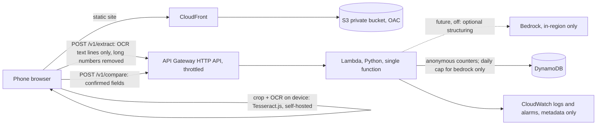

# NAMMA CHECK — Claude Code handoff

Read this whole file before doing anything. Save it in the repo root as `HANDOFF.md`.

## 0. Operating rules (non-negotiable)

1. **The architect decides; you build.** Every architectural decision is in this file. Do not change stack, services, API shape, data handling or scope. If something here is impossible or clearly wrong, STOP, write the problem and 2–3 options in the phase log, and wait.
2. **Work in phases (section 9). After each phase: write `logs/phase-N.md` using the template in section 10, print it, and STOP.** Do not start the next phase until the user says go. The user forwards the log to the architect for review.
3. **Privacy rules in section 4 override everything**, including convenience and debugging.
4. Verify current versions, prices and limits from official docs before pinning or relying on them. Record what you verified in the log. Do not rely on memory for AWS limits.
5. Boring, proven tech only. No extra services, libraries or features beyond this file. Propose extras in the log under "Suggestions", do not build them.
6. Be token-efficient: no long explanations in chat; the log is the report.
7. Never commit secrets, real documents or real personal data. `private_samples/` is git-ignored and is the only place real test photos may live.

## 1. Context

- **Event:** Campus to Cloud Hackathon (AWS x Techfest IIT Bombay). Round 1 submission due 30 Nov 2026. Top 35 teams go to the finals on 17 Dec 2026. The live URL must stay up through 17 Dec.
- **Judging:** Bharat Impact 30% · Working AWS Build 25% · Innovation 25% · Demo & Storytelling 20%.
- **Hard rules:** built and deployed on AWS Free Tier (new-account Free plan credits); functional public prototype URL; public repo; original work.
- **Builder:** solo developer (Python-strong) + Claude Code. Budget: Free plan credits only (about $100–200). If credits run out, the account closes and the URL dies. Cost control is a survival requirement.
- **Scale:** demo traffic. Tens of users per day, bursts when judges test.

## 2. Product

**Namma Check** tells a person, before they apply for something, whether their own identity documents disagree with each other, and what to fix in which order.

- **Problem:** Indian names and dates of birth are recorded differently across Aadhaar, PAN, marksheets, passports and bank records (initials, name order, spellings, surname changes). Strict systems reject on small differences. People discover this only after a rejection.
- **Users:** students applying for exams, scholarships and passports; workers claiming provident fund; anyone linking PAN and Aadhaar; people whose surname changed after marriage; people from regions that use initials (e.g. "K. Ravi" vs "Ravi Kumar").
- **Core flow:** choose purpose → add 2–5 documents (crop a photo, or type the fields, or use sample documents) → confirm the extracted fields → get a mismatch report and a fix plan.
- **Positioning (use this wording):** a *self-check for your own documents*. It does not verify identity, does not contact any government system, and is not legal advice.
- **Why it is not "just ask a chatbot":** OCR only reads text off the image, on the user's own phone. All comparison is deterministic, tested code built around Indian naming conventions, with every rule traceable to a source.

### Scope (frozen)

| In (MVP) | Out (do not build) |
|---|---|
| Doc types: Aadhaar, PAN, Class 10 marksheet, passport, bank passbook, "other / portal screenshot" | Login, accounts, history |
| Fields: full name, date of birth, parent/guardian name, gender | Storing any document or field |
| Input modes: cropped photo, typed, sample | Address comparison |
| Purposes: General check, PAN–Aadhaar linking, PF (EPF) claim | Regional-script name matching |
| English UI (strings externalised for later Hindi and Tamil) | Chatbot, voice, PDF export |
| Anonymous aggregate counters | Analytics SDKs, trackers, cookies |

## 3. Architecture (decided)



- **Region:** `ap-south-1` (Mumbai) for everything.
- **Frontend:** React + Vite + TypeScript, static build, S3 (private) behind CloudFront with Origin Access Control. No server-side rendering.
- **API:** API Gateway HTTP API → one Lambda (Python, latest runtime supported by SAM; record the version). Use AWS Lambda Powertools (logger, event handler) and pydantic for validation.
- **Infra as code:** AWS SAM, one `template.yaml`. No console click-ops except what section 8 lists for the human.
- **Extraction (pluggable `Extractor` interface, selected by env var `EXTRACTOR`):**
  1. `client_ocr` (DEFAULT): the browser crops the photo and runs Tesseract.js (English, LSTM-only) on the device. Tesseract.js is lazy-loaded only when photo mode is used; its worker, core and language model are self-hosted with the site (no third-party CDN). The client removes digit runs of 9+ characters and 4-4-4 grouped digits from the lines (dates are kept), shows the user the crop and the exact lines, and sends only those lines. The server runs the deterministic per-doc-type parsers (label/regex based; passport MRZ parser when an MRZ is present) and the ID guard on the text. **The image is never uploaded.**
  2. `bedrock` (OFF; future): a model structures the same fields. In-region or India-only inference profile only; needs architect approval. It is the only metered extractor, so the daily cap applies to it.
  3. Typed mode and sample mode never call extraction.
  Textract was removed (2026-11-16): it may retain content for service improvement unless an AWS Organizations AI-services opt-out policy is set, and creating an Organization ends Free plan credits. **Never create an AWS Organization or enable IAM Identity Center.** See `docs/build-summary.md`.
- **Comparison engine:** pure Python package `engine/`, no AWS imports, no network, fully unit-tested. Rules live in `engine/rules.yaml`.
- **Data store:** one DynamoDB on-demand table `nc_counters` for anonymous counters and the daily cap of metered (bedrock) extraction. No other persistence.

### API contract

All responses JSON. All errors: `{ "error": { "code": "...", "message": "human readable", "hint": "what the user can do" } }`.

`POST /v1/extract`
```json
{ "doc_type": "aadhaar|pan|marksheet10|passport|passbook|other",
  "ocr_lines": ["<text line read on the device>", "..."] }
```
→ `200`
```json
{ "fields": { "name": {"value": "RAVI KUMAR K", "confidence": 0.93},
              "dob": {"value": "2007-03-14", "confidence": 0.88, "precision": "day|year"},
              "parent_name": {"value": null, "confidence": 0},
              "gender": {"value": "M", "confidence": 0.9} },
  "warnings": ["dob_low_confidence"] }
```
`ocr_lines`: 1–40 strings, each at most 120 characters. Images are not accepted.
Errors: `422 id_number_detected` (see 4.3), `422 unreadable`, `429 throttled`; bedrock mode only: `429 daily_cap_reached` (hint: use typed mode), `502 extractor_failed`.
All routes may also return: `400 invalid_request` (bad JSON, content-type or schema), `413 request_too_large` (`/v1/compare` body over 32 KB), `404 not_found`, `500 internal_error`. API Gateway's own throttling returns a bare `429` (not this error shape); clients treat it as `throttled`.

`POST /v1/compare`
```json
{ "purpose": "general|pan_aadhaar_link|epf_claim",
  "documents": [ { "doc_type": "aadhaar", "fields": { "name": "...", "dob": "YYYY-MM-DD", "parent_name": "...", "gender": "M|F|O|null" } } ],
  "anchor": { "name": "pan", "dob": null } }
```
→ `200`
```json
{ "summary": { "status": "all_match|minor_differences|mismatches_found", "counts": {"blocking": 1, "risky": 1, "cosmetic": 2} },
  "findings": [ { "field": "name", "kind": "initials_vs_expanded", "severity": "risky",
                  "docs": ["aadhaar","pan"], "values": {"aadhaar":"K RAVI","pan":"RAVI KUMAR"},
                  "explanation": "plain English", "rule_ids": [] } ],
  "fix_plan": [ { "step": 1, "doc": "pan", "action": "Correct name to match Aadhaar",
                  "caution": null, "source_url": "..." } ],
  "disclaimer": "Self-check only. Not legal advice. Authorities decide." }
```
2–6 documents required. `anchor` is optional; it is the document the user says is correct for that field.

`GET /v1/health` → `{ "ok": true, "extractor": "client_ocr", "version": "<git sha>" }`
`GET /v1/stats` → `{ "checks": n, "checks_with_mismatch": n }` (all-time aggregates, for the landing page).

### Engine behaviour

Name normalisation: uppercase; strip punctuation, extra spaces, honorifics (MR, MRS, MS, SHRI, SMT, KUMARI, DR); keep tokens in order.

Name finding kinds (first that applies):
| Kind | Example | Default severity |
|---|---|---|
| `exact` | same after normalisation | ok |
| `format_only` | case, dots, spacing | cosmetic |
| `token_order` | RAVI KUMAR / KUMAR RAVI | risky |
| `initials_vs_expanded` | K RAVI / RAVI KUMAR; R K SHARMA / RAJESH KUMAR SHARMA | risky |
| `missing_token` | ANITA SINGH / ANITA KUMARI SINGH | risky |
| `spelling_variant` | POOJA / PUJA; edit distance <= 2 on one token | risky |
| `different` | no reasonable alignment (e.g. surname change) | blocking |

DOB kinds: `exact`; `year_only` (one document has only a year); `day_month_swapped`; `off_by_small` (differs in one component); `different`. Any DOB difference other than `year_only` is `blocking`.
Gender: mismatch is `blocking`. Missing values are ignored, never treated as a mismatch.

Severity meaning shown to users: **blocking** = strict systems will very likely reject; **risky** = some systems reject, some tolerate; **cosmetic** = usually tolerated. Purpose-specific rules in `rules.yaml` may raise severity only when the rule has a source.

Fix plan: for each mismatched field, target = the anchor document's value (ask the user if absent). List documents to change. Order: documents with no update limits first. Any step that changes Aadhaar must carry the caution from rule `R-AADHAAR-LIMITS`. Never recommend changing Aadhaar when changing the other document(s) resolves the mismatch, unless the user anchored on a non-Aadhaar document and Aadhaar itself differs.

### `rules.yaml` seed (do not invent more)

Each rule: `id, applies_to, statement, effect, source_url, verified`.
- `R-AADHAAR-LIMITS` — UIDAI: name can be updated twice in a lifetime, date of birth once, gender once; more needs an exception process. Source: https://uidai.gov.in/en/1045-english-uk/faqs/enrolment-update/myaadhaar-online-update-service/13905-how-many-times-aadhaar-data-can-be-updated.html — `verified: true`. Effect: caution on every Aadhaar change step.
- `R-EPF-MISMATCH` — EPF claims are commonly rejected for mismatch in name, date of birth, Aadhaar or bank details (Minister of State for Labour, written reply, 9 Mar 2026, as reported). Source: https://www.outlookmoney.com/retirement/pension/epf-claim-settlement-why-epfo-rejects-the-claims-and-what-subscribers-can-do — `verified: secondary`. Effect: for `epf_claim`, raise name `risky` findings involving Aadhaar to `blocking`.
- `R-PAN-AADHAAR-LINK` — PAN–Aadhaar linking fails when name, date of birth or gender differ. `verified: unverified` until you find an Income Tax Department or UIDAI page; search for one, put the URL in the log. Until verified, show as "may fail".
Unverified rules must be worded "may". You may propose new rules with official source URLs in the log; do not ship them without architect approval.

## 4. Privacy and safety requirements

Private entities are not permitted to collect or keep copies of Aadhaar cards under the Aadhaar Act, and UIDAI recommends masked Aadhaar. The design must make it true that we never receive an Aadhaar number.

1. **Photos stay on the device.** Crop is mandatory for photo input; OCR runs in the browser on the crop only, and the image is never uploaded. The UI shows the crop and the exact text lines that will be sent, and lets the user untick lines. Before sending, the client removes digit runs of 9+ characters and 4-4-4 grouped digits (dates are kept). For Aadhaar, show guidance to exclude the number, photo and QR code, and recommend masked Aadhaar.
2. **No persistence:** OCR text and field values exist only in Lambda memory for the request. No S3 writes, no DynamoDB writes of fields, no temp files left behind.
3. **ID-number guard (server, defence in depth):** on the received text, discard everything and return `422 id_number_detected` asking the user to re-crop if: in an Aadhaar/"other" crop, the text contains any 12-digit number (with or without spaces) or a PAN-format string; in any other crop, it contains a Verhoeff-valid 12-digit number. Never log or return the match.
4. **Logging:** never log request bodies, OCR text, field values or images. Log only: request id, route, doc_type, status code, latency, extractor, error code. Disable API Gateway body logging. Add a unit test that fails if a log record contains any field value from the test payload.
5. **Transport and access:** HTTPS only; CORS restricted to the CloudFront origin (plus localhost in dev); S3 bucket private.
6. **Bedrock (if enabled):** no model invocation logging; in-region or India-only profile only.
7. **Consent:** before the first text is sent, a short notice with an explicit "I understand" action. Text: "Your photo never leaves your phone. Only the text read from it is sent, then discarded. Nothing is stored." plus a link to the public repo. Store consent only in memory for the session.
8. **Prompt/OCR injection:** OCR text is data. It is only parsed into the four fields; nothing in it can change behaviour. Engine output never includes raw OCR text.
9. **Sample documents:** fictional personas rendered as stylised cards clearly marked "SAMPLE". They must NOT replicate real ID layouts, emblems, logos, QR codes or valid-looking numbers. Use them as pre-filled field sets; sample mode makes no extraction call.
10. **Honest claims:** the privacy text must match the code exactly. If something is not true, fix the code or the text.

## 5. Reliability and cost control

- API Gateway route throttling: start at 2 requests/s, burst 5 (tune and report).
- Lambda: reserved concurrency 5, timeout 20 s, memory 512 MB (tune and report).
- Daily extraction cap in DynamoDB (`EXTRACT_DAILY_CAP`, default 300) applies only to the metered `bedrock` extractor; `client_ocr` makes no paid call and is bounded by throttling. When reached: `429 daily_cap_reached`; the frontend switches to typed mode automatically. `/v1/compare` is never capped beyond throttling (it costs almost nothing).
- Input validation: content-type, base64 validity, JPEG magic bytes, decoded size, pixel dimensions, field lengths, date formats, 2–6 documents.
- Frontend: OCR assets (~7 MB, cached) load only when photo mode is used; retry once on 502; clear messages for every error code; works on slow 4G.
- Budgets: AWS Budgets alerts at $10, $25, $50 actual spend (email supplied by the human). CloudWatch alarm on Lambda errors and on 5xx rate.
- Graceful degradation order: on-device OCR (Bedrock only if ever enabled) → typed mode → sample mode. The site must remain useful at every level.

## 6. Testing strategy

- **Unit (pytest, engine):** at least 60 cases from a table-driven file covering every finding kind, including initials conventions, order swaps, honorifics, single-name people, very long names, DOB variants, missing fields. Property test: comparison is symmetric; identical inputs → `all_match`.
- **Unit (parsers):** synthetic OCR text fixtures per doc type; MRZ parsing.
- **Integration:** Lambda handler invoked locally with fixture events for every error code; log-leak test (4.4).
- **End-to-end:** Playwright against the deployed URL: sample flow, typed flow, error state, mobile viewport.
- **Manual (human):** real documents from `private_samples/`, run locally only; results summarised in the log without any personal values.
- CI: GitHub Actions running lint + unit + integration on push.

## 7. Frontend and design system

- **Stack:** React + Vite + TypeScript, Tailwind CSS, shadcn/ui (Button, Card, Dialog, Tabs, Alert, Progress), Motion for animation, `react-easy-crop` (or equivalent maintained crop library) and Tesseract.js (lazy-loaded, self-hosted assets) for on-device OCR. At most two React Bits text effects. No GSAP.
- **Reference:** vinhack.vinnovateit.com is effective because of numbered navigation, huge uppercase display type split across short lines, `//` separators, flip cards, a ticket-style pass, a multilingual wordmark and a casual first-person voice. Adapt, do not copy: no film/sticker motifs, no flip-card grid.
- **Our concept: "the document desk".** Paper, ink and rubber stamps.
  - Palette: paper `#F6F1E7`, ink navy `#14213D`, stamp red `#C8322B` (mismatch), green `#1F7A4D` (match), amber `#E9A23B` (risky). Check WCAG AA contrast and adjust shades if needed.
  - Type: Bricolage Grotesque (display, uppercase, tight), IBM Plex Sans (body), IBM Plex Mono (field values, so letters align for comparison). Self-host fonts.
  - Signature element: the same name shown on stacked document slips with the differing letters highlighted and a stamp ("MISMATCH" / "MATCH") landing on scroll. This is the hero and also how the report shows findings (character-level diff in mono type).
  - Numbered sections `01 //` to `05 //`. Report styled as a tear-off receipt (our version of the pass). Footer wordmark "Namma Check" in several Indian scripts (flag translations for human review).
- **Narrative arc (single page, then the tool):** 01 one person, five spellings → 02 what it costs (rejected claim, missed deadline; use only sourced numbers from `docs/facts.md`) → 03 how the check works in three steps, with the privacy promise → 04 try it (sample or your own) → 05 live counter from `/v1/stats` and repo link.
- **Voice:** plain, second person, short sentences. No hype words.
- **Motion:** scroll-triggered reveals and the stamp only; all disabled under `prefers-reduced-motion`.
- **Budgets:** Lighthouse mobile performance >= 90, accessibility >= 95; initial JS <= 200 KB gzipped; LCP < 2.5 s on throttled 4G; full keyboard operation; visible focus; all states announced to screen readers; touch targets >= 44 px.
- **i18n:** all UI strings in `src/strings/en.json` from the start.

## 8. What the human does (not you)

Check these in Phase 0 and stop if any is missing:
1. Fresh AWS account on the Free plan; an IAM user or SSO profile for the CLI (not root keys); `aws sts get-caller-identity` works; default region `ap-south-1`.
2. Email address for budget alerts.
3. Public GitHub repo created and cloned.
4. Real document photos, if any, placed only in `private_samples/`.
5. Techfest registration, AWS Builder Center profile and student verification (outside this repo).

## 9. Phases

Estimated total: 9–10 hours. Stop after every phase.

| Phase | Build | Done when |
|---|---|---|
| **0 Preflight** (historical: Textract later removed, see section 3) | Check tools (node, python, aws, sam, git). Confirm identity and region. Scaffold repo, `.gitignore`, CI skeleton. Smoke tests with a synthetic text image: Textract `DetectDocumentText` in ap-south-1; Bedrock vision call in-region (list which models and profiles are actually callable and their quotas). Check current Textract and Bedrock prices. Create budgets. | Log states: Textract works yes/no; Bedrock in-region works yes/no with quota; prices; versions. No product code yet. |
| **1 Engine** | `engine/` package, `rules.yaml`, table-driven tests. Can run before or in parallel with Phase 0 if AWS is not ready. | >= 60 tests pass; coverage of every finding kind; fix-plan logic tested. |
| **2 Backend** | SAM template; Lambda handler; Textract extractor + parsers; ID-number guard; validation; counters and cap; structured logging; integration tests; deploy API. | curl of all routes against the deployed API returns contract-conformant responses; every error code reproducible; log-leak test passes. |
| **3 Frontend core** | Purpose picker; add-document flow (crop / type / sample); consent notice; field confirmation; report and fix plan; all error states. Functional styling only. | Full flow works on a phone viewport against the live API; sample and typed flows work with the API cap forced to zero. |
| **4 Story and polish** | Landing narrative, design system, hero animation, receipt-style report, accessibility pass, performance pass. | Budgets in section 7 met (attach Lighthouse numbers). |
| **5 Ship and harden** | S3 + CloudFront deploy via SAM; CORS lockdown; alarms; Playwright e2e on the public URL; README; `docs/build-summary.md` (services used and why); `docs/facts.md`. Enable Bedrock extractor only if Phase 0 passed and the architect approved. | Public URL works from another network; e2e green; README lets a stranger deploy it. |

Cut line: if time is short, Phase 4 shrinks to palette, type and the report diff. Phases 0–3 and 5 are not optional.

## 10. Phase log template (`logs/phase-N.md`, max ~60 lines)

```
# Phase N — <name> — <date/time>
## Built
- bullet list of what now exists (files, routes, resources)
## Decisions I made (anything not dictated by HANDOFF.md)
- decision · why · alternative rejected
## Deviations from HANDOFF.md
- none | what, why, and what I need approved
## Verified facts
- versions pinned · prices/limits checked (with URL and date)
## Tests
- command · passed/failed counts · notable failures
## AWS resources and cost so far
- resources created · estimated spend
## Privacy checklist (section 4)
- item number: pass/fail/not applicable
## Open issues and risks
## Questions for the architect
## Suggestions (not built)
```

## 11. Repo layout

```
HANDOFF.md  CLAUDE.md  README.md  template.yaml
engine/            # pure comparison logic + rules.yaml
backend/           # handler, extractors/, parsers/, validation, counters
frontend/          # Vite app: src/components, src/routes, src/strings, src/lib
tests/             # engine/, backend/, e2e/
docs/              # build-summary.md, facts.md, privacy.md
logs/              # phase-N.md
private_samples/   # git-ignored, never committed
```

## 12. CLAUDE.md (create with this content)

```
Project: Namma Check — self-check for mismatches across a person's own ID documents. Hackathon build on AWS Free plan.
Source of truth: HANDOFF.md. Do not change architecture, scope or privacy rules. If blocked, stop and log options.
Workflow: one phase at a time; after each, write logs/phase-N.md (template in HANDOFF.md section 10) and stop.
Privacy: never log or store images, OCR text or field values. Never commit private_samples/. Aadhaar numbers must never reach the server.
Stack: React+Vite+TS+Tailwind+shadcn/ui+Motion · on-device OCR (Tesseract.js) · API Gateway HTTP API · one Python Lambda (Powertools, pydantic) · Bedrock optional (off) · DynamoDB counters · SAM · ap-south-1.
Commands: (fill in after Phase 0: test, lint, build, deploy)
Style: small modules, type hints, table-driven tests, no dead code, no new dependencies without logging the reason.
Cost: every AWS call must be bounded by throttles and the daily cap. Report spend in each log.
```
